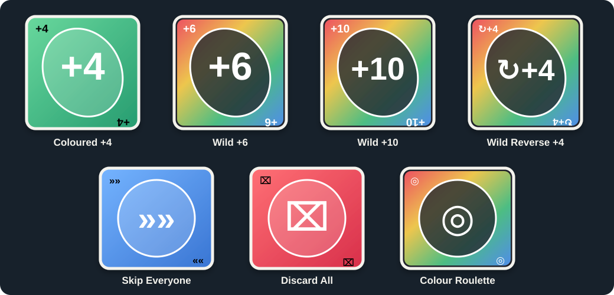

# Friend UNO

Private-room multiplayer UNO for friends. Node.js, Express and socket.io; no database needed.

## Run

```
npm install
npm start          # http://localhost:3000
```

Environment variables: `PORT`, `DATA_DIR` (where `rooms.json` is saved, default `./data`),
`UNO_RATE_LIMIT=off` (disables rate limiting, used by the tests), `UNO_STATS=off` (no hall of fame).

## Rooms and play

- 2–20 players per room, plus up to 30 spectators (anyone joining a running game watches).
- Your seat is tied to a secret token in the browser. Refresh or lose connection and you return to your seat;
  a dropped seat is held for 30 seconds before it is released.
- While you are away, your turns are played automatically. Rooms survive server restarts (saved to `DATA_DIR`).

## Bots, chat and results

- **Computer players:** the host can add or remove bots in the waiting room (up to 20 seats in total). They think for about a second, keep Wilds for later, go after players who are nearly out, and sometimes forget to call UNO.
- **Rules:** a Rules button (bottom left, opposite Chat) opens a panel with the rules from this README: scoring, game styles, No Mercy cards, house rules and the turn timer.
- **Chat and reactions:** a Chat button (bottom right) with eight quick reactions that float up from the sender's seat. Spectators can chat too. Messages are plain text, 120 characters, and rate-limited.
- **Hall of fame:** the home page lists all-time game wins, round wins and rounds played per player *name* (there are no accounts). Bots never count. Numbers are kept in `DATA_DIR/stats.json`. Set `UNO_STATS=off` to disable the list and the counting. Anyone who can open the site can see the names on it.

## Display and mobile

- **Invite link:** the Invite button copies `https://your-site/?room=ABCD` (phones open the share sheet). Opening it pre-fills the room code.
- **Display menu** (top right): Auto / Dark / Light theme, four card backs, and colour-blind symbols (a shape on every colour). Saved in the browser.
- **Phones:** drag a card upwards to play it (a tap still works), bigger Draw / UNO / Pass buttons, and a compact layout when held sideways.
- Cards are the same size in your hand, on the discard pile and in the draw pile. Your hand is fanned, the discard pile shows the last few cards at slightly different angles, the draw pile looks like a stack, opponents hold fanned card backs, and a played card slides from its place to the pile, turning into the pile's angle as it lands. Drawn cards fly one after another from the draw pile into your hand, or into the fan of the opponent who drew them.
- Shuffle and deal animation at round start, confetti for a round win (bigger for the game). All motion respects "reduce motion".

## Scoring

Official UNO points: numbers face value, Skip / Reverse / Draw Two 20, Wild / Wild +4 50.
- **Winner scores**: the round winner collects everyone's leftover cards; first to the target (default 500) wins.
- **Penalty (lowest wins)**: everyone else adds their own leftover cards; the game ends at the target and the lowest total wins.
- **Team mode**: seats 1/3/5… against 2/4/6…, sharing one score (even player count, at least 4).

## Game styles

Pick a preset when creating a room (you can still change every switch afterwards):
- **Classic**: the usual rules.
- **Chaos**: every house rule on (stacking incl. +4, jump-in, 7-0, forced play, challenge +4) with a 30 s turn timer.
- **No Mercy**: based on UNO Show 'Em No Mercy (rules from the [official rules summary](https://officialgamerules.org/game-rules/uno-show-em-no-mercy/)).
  168-card deck with +4 (coloured), Wild +6, Wild +10, Wild Reverse +4, Skip Everyone, Discard All and Colour Roulette.
  Draws stack onto any equal or bigger draw card (in any colour), you draw until you can play, 7-0 is always on,
  and holding 25 cards knocks you out for the round. Scoring: leftover cards as usual, 250 per knocked-out player; first to 1000.
  The exact card counts are not published, so the split of the 168 cards is our own. In a two-player game Reverse +4 sends the
  penalty back to whoever played it, as the official summary says. Team mode and penalty scoring are not available.

### No Mercy special cards

The illustrations below show the seven special card designs used in this project. The coloured cards are shown as examples; their background colour can be red, yellow, green or blue.



- **Coloured +4** — The next player must draw four cards unless they can stack an eligible draw card. Unlike a Wild card, it does not let you choose the active colour; the card's printed colour becomes active.
- **Wild +6** — Choose the active colour. The next player receives a six-card draw penalty, which can be stacked with a draw card worth six or more.
- **Wild +10** — Choose the active colour. The next player receives a ten-card draw penalty, which can only be passed on with another +10 under the equal-or-higher stacking rule.
- **Wild Reverse +4** — Choose the active colour, reverse the direction of play and give the four-card penalty to the player in the reversed direction. With two players, the penalty comes back to the player who played it.
- **Skip Everyone** — Every other player is skipped, so the player who used the card immediately takes another turn.
- **Discard All** — Discard every other card in your hand that matches this card's colour. The Discard All card itself stays on top of the discard pile.
- **Colour Roulette** — The next player chooses a colour, then draws cards until they draw a card of that colour. They miss their turn afterwards.

**No Mercy stacking reminder:** draw penalties can be stacked on any draw card of equal or greater value, regardless of colour. If you cannot or choose not to stack, you draw the accumulated amount.

## House rules and optional rules

The host chooses a preset when creating a room and can adjust the switches before starting. The
**Classic** preset uses the standard house-rule defaults listed below. **Chaos** enables all of
the house and extra rules, including +4 stacking, Jump-in, 7-0, Forced play and Challenge +4, and
sets a 30-second turn timer. **No Mercy** is a separate game style with its own fixed rules (see
[Game styles](#game-styles)).

### Draw and penalty rules

- **Stack draw cards** — On by default. Instead of immediately taking a draw penalty, the next
  player can add an eligible draw card and pass the combined penalty to the following player.
  In a normal game, a +2 can be stacked on another +2. A Wild +4 can only be added when
  **Allow +4 stacking** is also enabled. If a player cannot or does not want to stack, they draw
  the accumulated penalty and lose their turn. Turning this rule off makes draw penalties apply
  immediately, except that Challenge +4 can still defer a Wild +4 so it can be challenged.
- **Allow +4 stacking** — Off by default. Allows a Wild +4 to be added to a pending draw penalty.
  It requires **Stack draw cards** to be enabled. Without it, a Wild +4 cannot be used to stack
  on another draw card.
- **Stack Skip cards** — On by default. Allows a Skip to be played on top of another Skip,
  including a Skip of a different colour. The played Skip still skips the next player as usual.

### Turn and hand rules

- **Call UNO** — On by default. When a player is reduced to one card, they have three seconds to
  press UNO. After that grace period, another player can catch them if they still have not called
  UNO. A caught player draws two cards. If they call within the three-second window, they cannot
  be caught for that one-card situation.
- **Draw one card** — On by default. When you draw a card because you cannot play, your turn
  ends immediately. If this is turned off, you keep the turn and may play the card you just drew
  if it is playable, or pass if you still cannot play.
- **Jump-in** — Off by default. You may play out of turn when you hold an exact match for the
  top discard: the same colour and the same value. It cannot be used while a draw penalty is
  pending or while a colour choice is being resolved. After jumping in, play continues from you.
- **7-0 swap** — Off by default. Playing a **7** lets you choose another active player and swap
  hands with them. Playing a **0** makes everyone pass their hand to the next active player in
  the current direction of play. These effects do not trigger when the card is your final card.
- **Forced play** — Off by default. If the card you draw is playable, you must play that exact
  card immediately instead of keeping it in your hand. This takes priority over the Draw one
  setting.
- **Challenge Wild +4** — Off by default. When a player plays a Wild +4, the next player may
  challenge it if it is the start of a new draw penalty. A +4 is illegal if its player still had
  a card matching the colour that was active before the Wild +4 was played. If the challenge is
  successful, the player who used the +4 draws four cards. If it fails, the challenger draws six
  cards and misses their turn. If the challenger accepts the +4 instead, they take the pending
  penalty as normal. When this rule is enabled, the +4 is held as a pending penalty so the next
  player can choose to challenge or accept it.

### Turn timer

- **Turn timer** — Off by default. The host can set 20, 30, 60 or 90 seconds. If a connected
  player runs out of time, the game automatically takes a card for them and ends their turn.
  Players who disconnect are played for automatically after a short grace period so the game
  can continue.

## Tests

```
npm test
```

Most server tests run on in-memory fakes (no network or ports). `test/e2e.test.js` starts the real server and plays a game
with real socket.io clients (needs `npm install`; skipped otherwise). The simulated players in `test/driver.js` only use what the
page itself receives. `test/ui.test.js` drives the real page in Chromium and is
skipped automatically if Playwright is missing; to enable it run `npx playwright install chromium`.

## Notes

- Commit `package-lock.json` after your first `npm install`; CI uses `npm ci` when it exists.
- Rate limits: 10 actions/s (burst 25) per connection; room create/join 0.5/s (burst 5).
